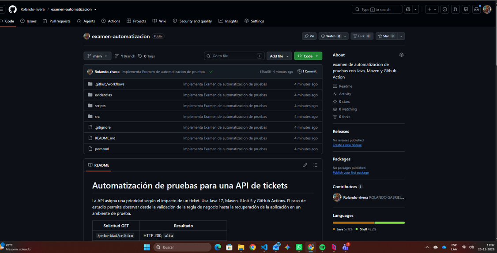
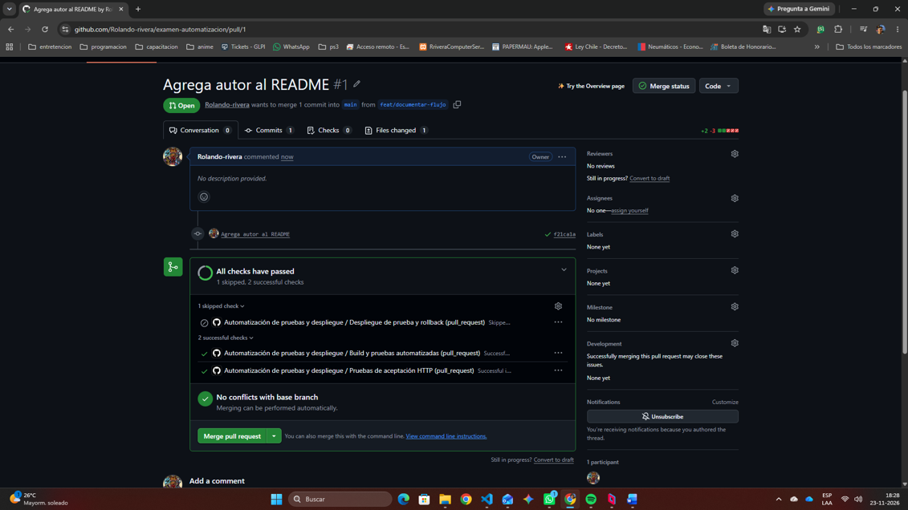
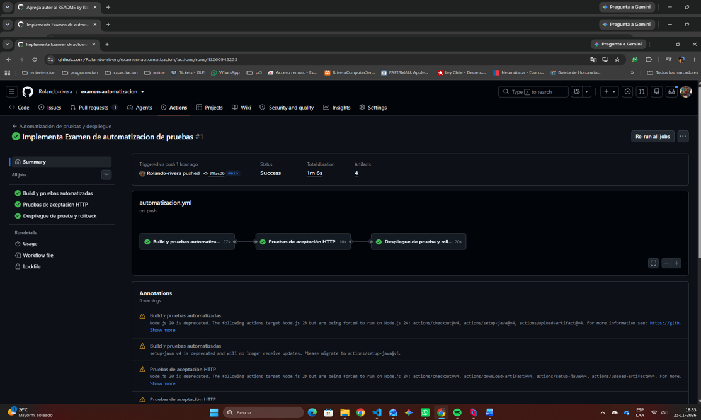
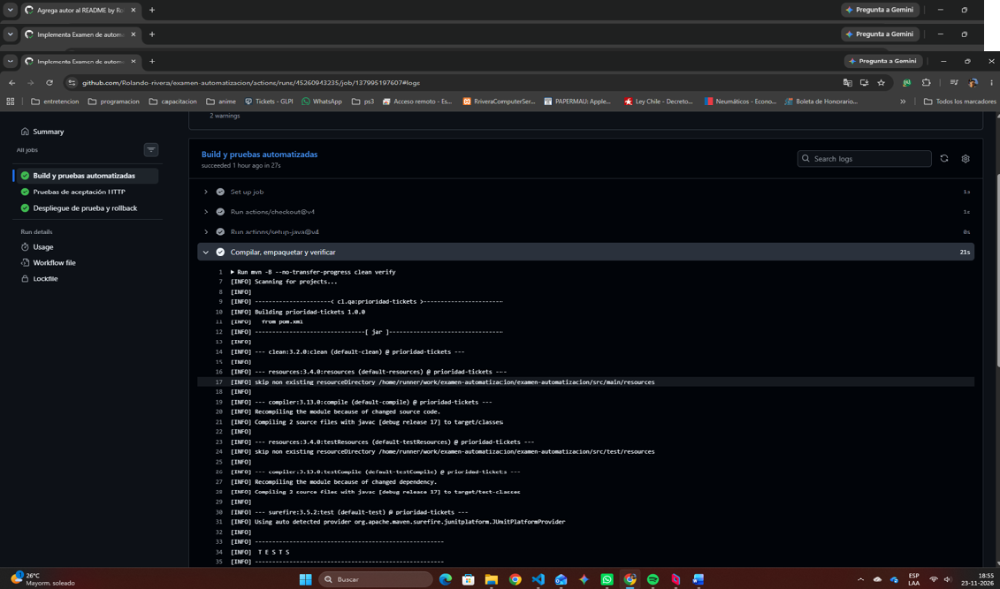
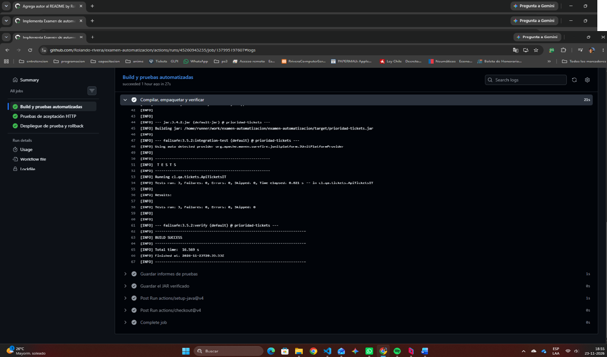
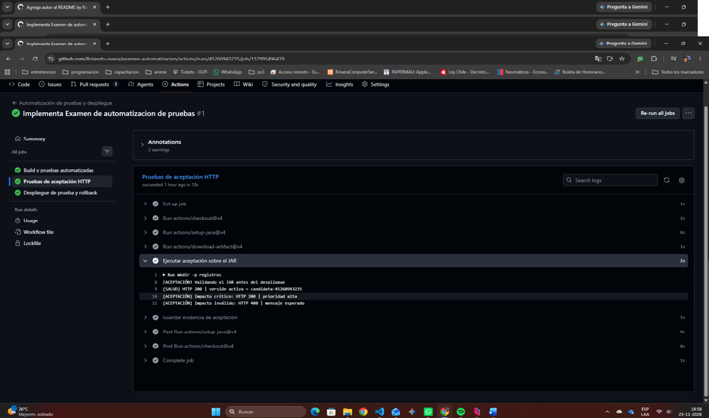
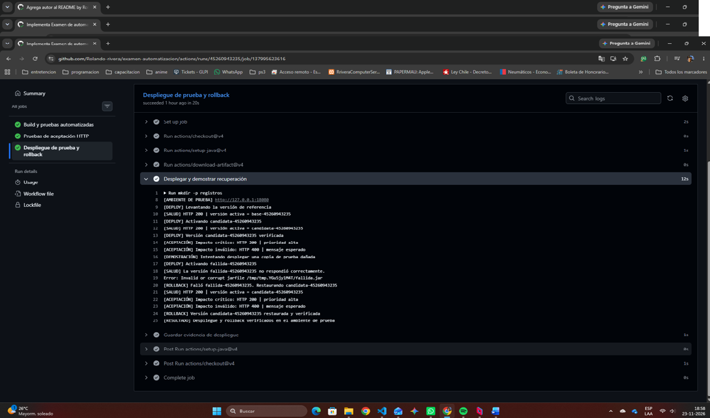

# Examen final de Automatización de Pruebas

**Autor** Rolando Rivera  
**Institución** Instituto Profesional Iplacex

Este proyecto implementa una API de prioridad de tickets y automatiza su compilación, pruebas y despliegue en un ambiente temporal. El trabajo reúne las tres actividades del examen mediante Maven, JUnit y GitHub Actions.

La API recibe el impacto de un ticket y devuelve su prioridad. El pipeline valida la regla de negocio, las respuestas HTTP y el arranque del ejecutable. También provoca un fallo de despliegue para comprobar la recuperación de la última versión funcional.

- [Repositorio](https://github.com/Rolando-rivera/examen-automatizacion)
- [Ejecuciones de GitHub Actions](https://github.com/Rolando-rivera/examen-automatizacion/actions)
- [Pull Requests del proyecto](https://github.com/Rolando-rivera/examen-automatizacion/pulls?q=is%3Apr)

## Tecnologías

| Herramienta | Uso en el proyecto |
| --- | --- |
| Java 17 | Implementación y ejecución de la API |
| Maven | Gestión de dependencias, compilación y empaquetado |
| JUnit Jupiter 5.11.4 | Pruebas unitarias y de integración |
| Maven Surefire 3.5.2 | Ejecución de pruebas unitarias |
| Maven Failsafe 3.5.2 | Ejecución y verificación de pruebas de integración |
| Git y GitHub | Versionado y revisión mediante Pull Requests |
| GitHub Actions | Pipeline de CI, aceptación y despliegue |
| Bash y curl | Arranque, validación HTTP y rollback |

## Estructura del proyecto

| Ruta | Contenido |
| --- | --- |
| `pom.xml` | Dependencias de pruebas y plugins Maven |
| `src/main/java/cl/qa/tickets/ApiTickets.java` | Servidor HTTP y rutas de la API |
| `src/main/java/cl/qa/tickets/Prioridad.java` | Regla de clasificación del impacto |
| `src/test/java/cl/qa/tickets/PrioridadTest.java` | Suite de pruebas unitarias |
| `src/test/java/cl/qa/tickets/ApiTicketsIT.java` | Suite de integración HTTP |
| `.github/workflows/automatizacion.yml` | Pipeline versionado |
| `scripts/despliegue.sh` | Aceptación, despliegue y rollback |
| `evidencias/` | Registros locales y capturas de GitHub |
| `target/` | JAR e informes generados por Maven, excluidos del versionado |

## Actividad 1 Repositorio Git y proyecto Maven

### Flujo de ramas

Se utiliza Trunk-Based Development con `main` como rama principal. Los cambios se realizan en ramas cortas y se integran mediante un Pull Request después de revisar las comprobaciones automáticas.

El flujo de trabajo es el siguiente.

1. Actualizar la rama `main` local.
2. Crear una rama corta, por ejemplo `feat/documentar-flujo`.
3. Realizar un cambio y registrarlo con un commit.
4. Subir la rama y abrir un Pull Request hacia `main`.
5. Revisar el resultado de CI y aceptación.
6. Fusionar el Pull Request y comprobar el pipeline completo de `main`.

Para un nuevo cambio de documentación se puede utilizar esta secuencia desde la carpeta del proyecto.

```bash
git switch main
git pull origin main
git switch -c docs/actualizar-documentacion
```

Después de editar y guardar el README, se registra y publica el cambio.

```bash
git add README.md
git commit -m "Actualiza documentacion del examen"
git push -u origin docs/actualizar-documentacion
```

La rama `docs/actualizar-documentacion` debe estar disponible para crearla. En cambios posteriores se utiliza otro nombre descriptivo.

### Configuración Maven

El archivo `pom.xml` configura Java 17, codificación UTF-8 y JUnit Jupiter como dependencia de pruebas. Los plugins Compiler y Jar generan el ejecutable `target/prioridad-tickets.jar`. Surefire y Failsafe ejecutan las suites unitarias y de integración, respectivamente.

### Rutas de la API

| Solicitud GET | Estado HTTP | Cuerpo esperado |
| --- | --- | --- |
| `/prioridad/critico` | 200 | `alta` |
| `/prioridad/moderado` | 200 | `media` |
| `/prioridad/bajo` | 200 | `baja` |
| `/prioridad/otro` | 400 | `impacto inválido` |
| `/salud` | 200 | Identificador de la versión activa |

## Actividad 2 Integración continua y pruebas automatizadas

### Estrategia de pruebas

| Tipo | Casos implementados | Propósito |
| --- | --- | --- |
| Unitarias | Cuatro casos en `PrioridadTest` | Validar los tres impactos permitidos y el rechazo de un impacto desconocido |
| Integración | Tres casos en `ApiTicketsIT` | Comprobar por HTTP la prioridad crítica, la entrada inválida y la versión activa |
| Aceptación | Salud y dos escenarios HTTP en `despliegue.sh` | Validar el JAR empaquetado antes del despliegue |

Las pruebas unitarias permiten localizar errores en la regla de clasificación. Las de integración levantan un servidor real en un puerto dinámico y comprueban los códigos HTTP y el cuerpo de las respuestas. El servidor se detiene al finalizar la suite.

Las pruebas de aceptación utilizan el mismo JAR que genera CI. Esto permite validar el artefacto que se utilizará en el despliegue.

### Pipeline de CI

El workflow se encuentra en [automatizacion.yml](.github/workflows/automatizacion.yml). Se activa con un push a `main`, con un Pull Request dirigido a `main` o mediante ejecución manual.

El job **Build y pruebas automatizadas** configura Java 17 y ejecuta el siguiente comando.

```bash
mvn -B --no-transfer-progress clean verify
```

El comando limpia la compilación anterior, compila, ejecuta las pruebas unitarias, genera el JAR y ejecuta y verifica las pruebas de integración. Un fallo impide que avancen los jobs dependientes.

### Ejecutar las pruebas localmente

Se requiere un JDK 17 y Maven compatible con el proyecto. Para los scripts de aceptación y despliegue se necesitan Bash y curl. En Windows, estos scripts pueden ejecutarse desde Git Bash.

Desde la carpeta que contiene `pom.xml`, se pueden verificar las instalaciones.

```bash
java -version
mvn -version
```

Para ejecutar las cuatro pruebas unitarias se utiliza lo siguiente.

```bash
mvn -B clean test
```

Para compilar, empaquetar y ejecutar las siete pruebas de ambas suites se utiliza lo siguiente.

```bash
mvn -B clean verify
```

Los resultados esperados son cuatro casos unitarios y tres de integración, con cero fallos y errores, y el mensaje `BUILD SUCCESS`. Los informes quedan en `target/surefire-reports/` y `target/failsafe-reports/`.

Para iniciar manualmente la API después de construir el JAR se utiliza lo siguiente.

```bash
java -jar target/prioridad-tickets.jar 18080 manual
```

Desde otra terminal se pueden consultar `http://127.0.0.1:18080/salud` y `http://127.0.0.1:18080/prioridad/critico`. La instancia manual se detiene con Ctrl+C antes de ejecutar scripts que usen el mismo puerto.

## Actividad 3 Aceptación y despliegue con rollback

### Etapas del pipeline

| Job | Operación | Condición de avance |
| --- | --- | --- |
| Build y pruebas automatizadas | Construye el JAR y ejecuta las suites Maven | Compilación y pruebas aprobadas |
| Pruebas de aceptación HTTP | Descarga el JAR, inicia la candidata y consulta sus rutas | Salud y respuestas HTTP correctas |
| Despliegue de prueba y rollback | Activa una candidata y comprueba la recuperación ante un fallo provocado | Despliegue sano y rollback verificado |

El job de despliegue está condicionado a `main`. En un Pull Request, CI y aceptación se ejecutan y el despliegue se omite. Después de fusionar, el push a `main` permite ejecutar las tres etapas.

### Ejecutar aceptación localmente

Desde Bash y después de `mvn clean verify`, se ejecuta el siguiente comando.

```bash
bash scripts/despliegue.sh acceptance target/prioridad-tickets.jar local
```

La validación comprueba que `/salud` devuelve la versión candidata, que un impacto crítico devuelve HTTP 200 con `alta` y que un impacto inválido devuelve HTTP 400 con el mensaje previsto.

### Ejecutar despliegue y rollback localmente

```bash
bash scripts/despliegue.sh deploy target/prioridad-tickets.jar local
```

El script realiza esta secuencia.

1. Copia el JAR a un directorio temporal y levanta una versión base.
2. Detiene la base, inicia la candidata y comprueba la versión activa.
3. Ejecuta la aceptación de la candidata.
4. Intenta activar una tercera copia con un JAR deliberadamente dañado.
5. Detecta el fallo de arranque y vuelve a levantar la última candidata sana.
6. Comprueba la versión restaurada y repite las consultas de aceptación.
7. Detiene la instancia y elimina el directorio temporal al finalizar.

El registro termina con el mensaje `[RESULTADO] Despliegue y rollback verificados en el ambiente de prueba` cuando se completa la demostración. El fallo del JAR dañado debe ir seguido de la restauración satisfactoria.

El script usa el puerto 18080. Si está ocupado, desde Git Bash se puede elegir otro puerto.

```bash
PORT=18081 bash scripts/despliegue.sh deploy target/prioridad-tickets.jar local
```

### Alcance del ambiente de prueba

En GitHub Actions, el despliegue utiliza el runner temporal y una dirección localhost. La aplicación permanece activa durante la demostración y se cierra al terminar. Base y candidata usan copias del mismo JAR con identificadores de despliegue diferentes. La copia dañada permite comprobar la recuperación ante un fallo de arranque.

La promoción reinicia el proceso y puede producir una interrupción breve. El ejercicio demuestra restauración del servicio y validación de respuestas HTTP. Su alcance corresponde al ambiente de pruebas del examen.

## Ejecutar y revisar el pipeline en GitHub

1. Abrir la pestaña **Actions** del repositorio.
2. Seleccionar **Automatización de pruebas y despliegue**.
3. Para ejecución manual, seleccionar **Run workflow**, elegir `main` y confirmar. El workflow debe existir en la rama predeterminada.
4. Abrir la ejecución y comprobar sus tres jobs.
5. Desplegar cada paso para revisar los registros y obtener las capturas.

El pipeline guarda los siguientes artefactos descargables en el resumen de la ejecución, según las etapas alcanzadas.

| Artefacto | Contenido |
| --- | --- |
| `informes-maven` | Reportes Surefire y Failsafe |
| `aplicacion` | JAR construido y verificado |
| `evidencia-aceptacion` | Registro de aceptación |
| `evidencia-despliegue` | Registro de despliegue y rollback |

## Evidencias

### Registros locales incluidos

La verificación local realizada durante la preparación del proyecto aprobó cuatro pruebas unitarias, tres de integración y las comprobaciones de aceptación y recuperación. Los registros están disponibles en los siguientes archivos.

- [Compilación y pruebas Maven](evidencias/01-maven-local.log)
- [Aceptación HTTP](evidencias/02-aceptacion-local.log)
- [Despliegue y rollback](evidencias/03-despliegue-local.log)

### Capturas de GitHub

Las imágenes siguientes utilizan los mismos nombres sugeridos en el informe. Para mostrarlas, deben estar subidas a la carpeta `evidencias` con esos nombres exactos.

#### Figura 1 Repositorio publicado

La vista Code debe mostrar el nombre del repositorio y los archivos del proyecto.



#### Figura 2 Flujo de ramas mediante Pull Request

La evidencia debe mostrar la rama de trabajo, su integración hacia `main` y el estado del Pull Request.



#### Figura 3 Pipeline completo

El resumen de una ejecución de `main` debe mostrar los tres jobs aprobados.



#### Figura 4 Pruebas unitarias

El registro de `PrioridadTest` debe mostrar cuatro casos con cero fallos y errores.



#### Figura 5 Pruebas de integración y construcción Maven

El registro de `ApiTicketsIT` debe mostrar tres casos aprobados y el resultado final `BUILD SUCCESS`. Si se usan dos capturas, se agrega la segunda imagen junto a esta evidencia.



#### Figura 6 Pruebas de aceptación HTTP

El registro debe mostrar la versión activa y las validaciones HTTP 200 y 400.



#### Figura 7 Despliegue y rollback

El registro debe mostrar la candidata desplegada, el fallo provocado y la recuperación verificada de la versión sana.



## Relación con los entregables del examen

| Actividad | Archivos y evidencias |
| --- | --- |
| Actividad 1 | Repositorio, `pom.xml`, estrategia Trunk-Based y Pull Request |
| Actividad 2 | Workflow versionado, suites unitarias y de integración e informes de ejecución |
| Actividad 3 | Script de aceptación y despliegue, validación de la candidata y evidencia del rollback |
| Documentación | README, capturas y documento Word de la entrega |

## Referencias

- [GitHub Docs — Creación y prueba de Java con Maven](https://docs.github.com/es/actions/tutorials/build-and-test-code/java-with-maven)
- [Apache Maven — Maven Surefire Plugin](https://maven.apache.org/surefire/maven-surefire-plugin/)
- [Apache Maven — Maven Failsafe Plugin](https://maven.apache.org/surefire/maven-failsafe-plugin/usage.html)
- [JUnit — Guía de usuario de JUnit 5.11.4](https://docs.junit.org/5.11.4/user-guide/)
